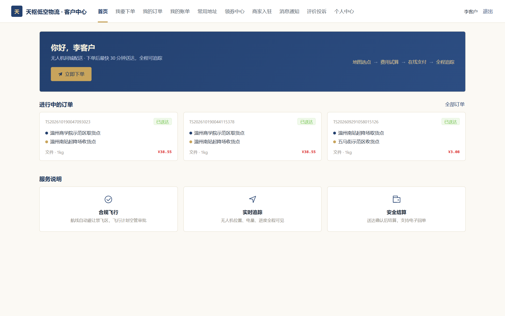
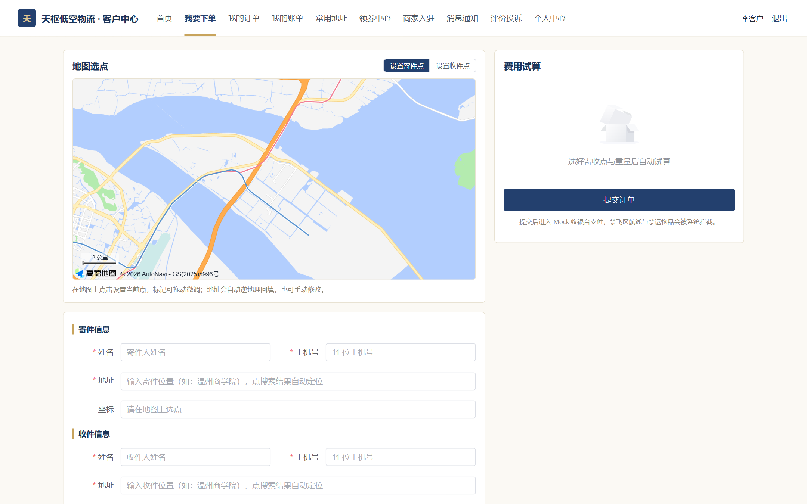
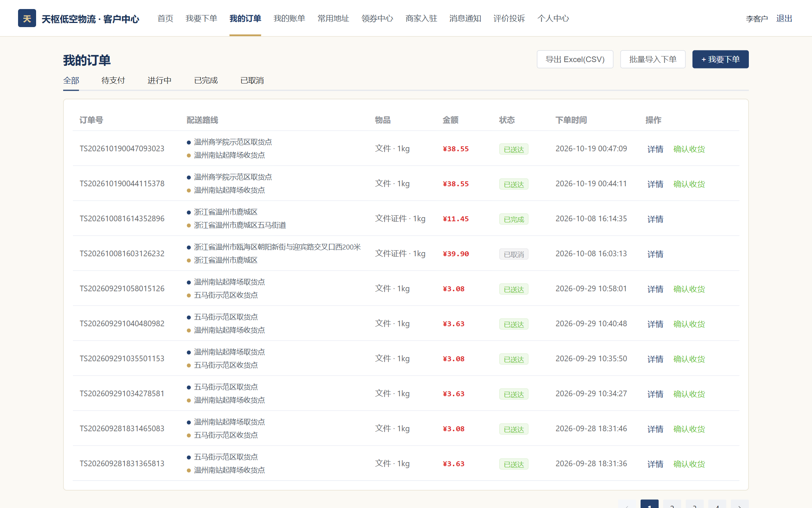
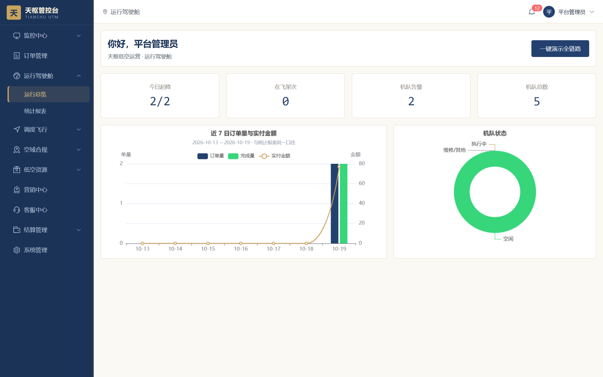
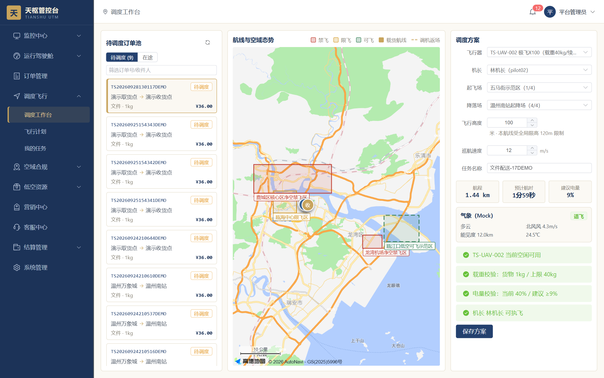
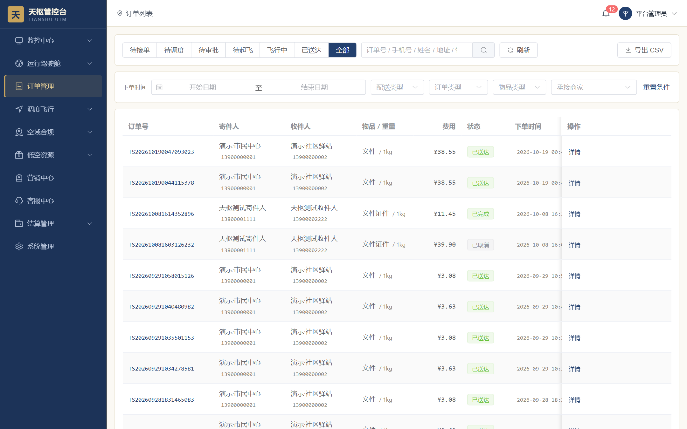
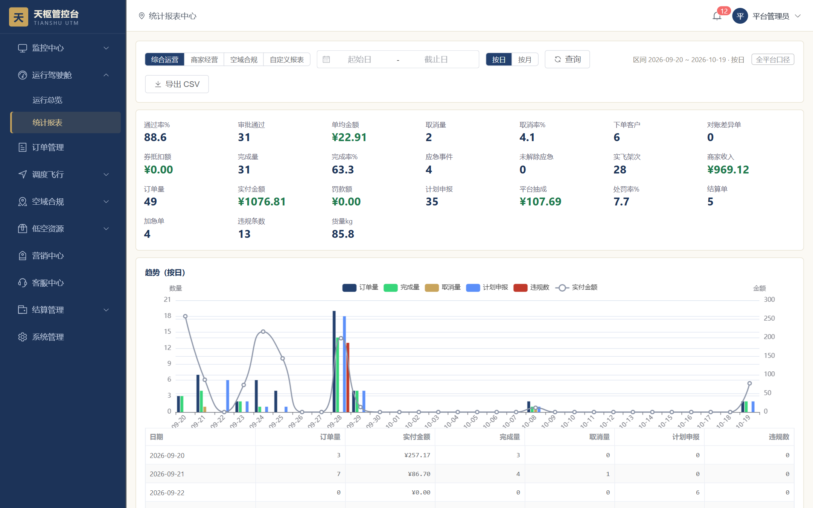
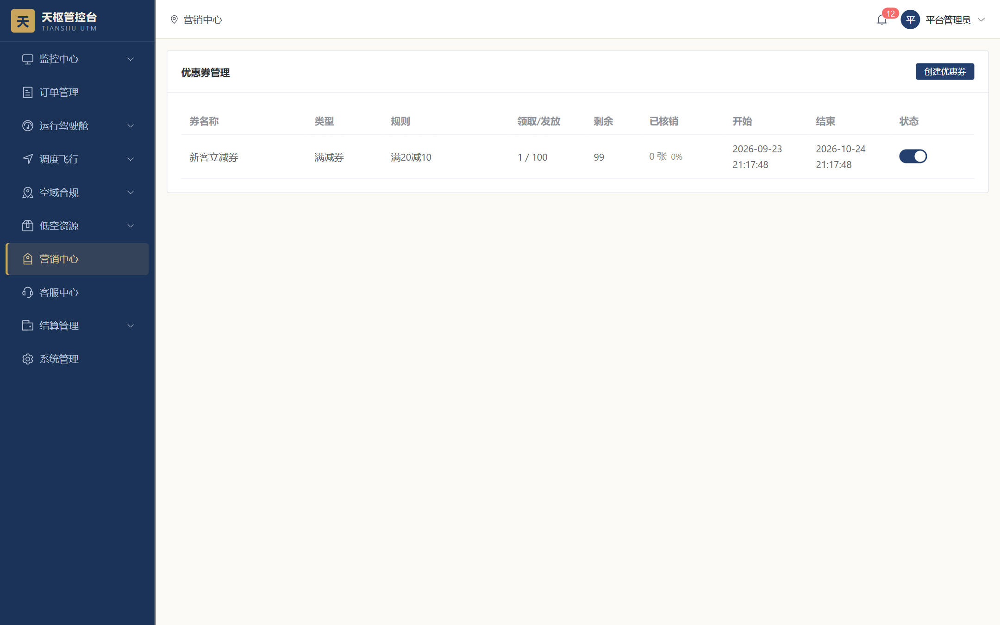

# 天枢 · 低空智能运营管控平台

**Tianshu Low-Altitude Intelligent Operation & Control Platform**

面向低空经济场景的无人机运控与配送服务平台 —— 本科毕业设计

覆盖客户、无人机运营商家、平台监管方三类主体，构建「下单 → 接单调度 → 空域审批 → 飞行监控 → 结算对账」的全链路闭环。


> **开发方式：Web Coding（AI 辅助编码）**
> 本项目以「设计文档驱动实现」的方式开发：领域建模、状态机、模块契约、数据库设计均先落成文档（见 [`设计/`](设计/)），
> 编码环节大量借助 AI 协作完成，每轮迭代后用 pytest 用例与端到端流程做回归验证。

---

## 目录

- [项目简介](#项目简介)
- [界面预览](#界面预览)
- [功能一览](#功能一览)
- [角色与权限](#角色与权限)
- [技术栈](#技术栈)
- [系统架构](#系统架构)
- [项目结构](#项目结构)
- [快速开始](#快速开始)
- [演示账号](#演示账号)
- [配置说明](#配置说明)
- [接口约定](#接口约定)
- [数据库设计](#数据库设计)
- [技术亮点](#技术亮点)
- [设计与文档](#设计与文档)
- [测试](#测试)
- [后续规划](#后续规划)
- [说明与声明](#说明与声明)

---

## 项目简介

低空经济作为国家战略性新兴产业，落地时普遍卡在三个环节：**空域资源管理分散、飞行审批流程繁琐、运营监控体系缺失**。传统的人工登记与分散式管理，既满足不了「安全管控」，也支撑不起「高效运营」。

本项目实现了一套面向低空无人机配送的运营管控平台，把一次无人机配送拆成可管控的六段流程，并让三方各司其职：

```
客户下单 ──▶ 商家接单 ──▶ 调度方案 ──▶ 空域审批 ──▶ 飞行监控 ──▶ 结算对账
   │            │            │            │            │            │
  下单试算     接单派单     指派机长     监管放行     轨迹回放     平台抽佣
```

**三方职责边界**

| 主体 | 角色 | 关心什么 |
|---|---|---|
| 客户 | `customer` | 下单、追踪、账单、优惠券 |
| 商家（无人机运营方） | `merchant_admin` / `dispatcher` / `pilot` / `finance` / `merchant_maintainer` | 接单、调度、机队维保、结算收款 |
| 平台（监管与运营） | `platform_admin` / `air_traffic` / `ops_maintainer` | 空域与禁飞区、飞行计划审批、违规处置、全局运行态势 |

---

## 界面预览

**客户门户** —— 下单、追踪、账单

| 首页（进行中订单 + 服务说明） | 我要下单（地图选点 + 费用试算） |
|---|---|
|  |  |

| 我的订单（按状态筛选 + 配送路线） | 领券中心（余量 / 有效期 / 已领状态） |
|---|---|
|  |  |

**商家 / 监管端** —— 驾驶舱、调度、订单、报表

| 运行驾驶舱（今日执飞 / 在飞架次 / 近 7 日趋势） | 调度工作台（订单池 + 空域态势 + 方案校验） |
|---|---|
|  |  |

| 订单管理（全状态筛选 + 导出） | 统计报表（通过率 / 实付 / 处罚率 / 趋势） |
|---|---|
|  |  |

| 营销中心（券模板 / 发放 / 核销统计） |
|---|
|  |

> 截图取自本地演示数据集（含 Mock 造数），非生产数据。

---

## 功能一览

### 客户门户（`/portal`）

| 页面 | 说明 |
|---|---|
| 首页 | 服务入口与推荐、可用机型与时效展示 |
| 下单 | 起终点选址、载重与时效选择、**提交前试算**（距离 / 重量 / 限飞区 / 加急） |
| 我的订单 | 订单列表与状态流转（待支付 / 待接单 / 已接单 / 执行中 / 已完成 / 已取消） |
| 订单详情 | 飞行进度、机长与飞行器信息、轨迹查看、取消与确认收货 |
| 账单 | 支付流水与结算明细 |
| 优惠券 | 领券、可用券筛选、下单抵扣 |
| 地址簿 | 常用收发地址维护 |
| 商户入驻 | 提交运营资质，申请成为平台入驻商家 |
| 消息 / 反馈 | 站内通知、投诉与意见反馈 |

### 商家运营端（`/admin`）

侧边栏按领域分为 11 个模块，菜单与接口权限均由角色权限点控制，无权限的菜单不会渲染。

| 模块 | 说明 |
|---|---|
| 监控中心 | 实时监控（飞行器位置 / 电量 / 告警）、轨迹回放、违规处置、应急事件 |
| 运行驾驶舱 | 今日执飞、在飞架次、机队告警、机队总数；近 7 日订单量与实付金额趋势、机队状态分布 |
| 统计报表 | 综合运营 / 商家经营 / 空域合规三张报表，支持按日按月与自定义区间，可导出 CSV |
| 订单管理 | 待接单 / 待调度 / 待审批 / 待起飞 / 飞行中 / 已送达 / 全部，多条件组合筛选 |
| 调度飞行 | 调度工作台（待调度订单池 + 航线与空域态势图 + 调度方案校验）、飞行计划、我的任务 |
| 空域合规 | 飞行计划审批、空域地图、空域台账、电子围栏、违规记录 |
| 低空资源 | 起降场站、飞行器档案、人员档案、资质台账、排班 |
| 营销中心 | 优惠券模板配置、发放与核销 |
| 客服中心 | 工单、投诉与评价处理 |
| 结算管理 | 结算单、支付流水（平台抽佣后结算） |
| 系统管理 | 用户、角色与权限分配、参数配置 |

### 平台监管端

与商家端共用界面，但按权限裁剪：`air_traffic` 只看到空域与审批，`platform_admin` 可跨商家查看全平台数据并管理用户与角色。

### 监管大屏（`/screen`）

独立全屏页面，用于运营监控与答辩演示：全平台实时运行态势、飞行器在线状态、当日订单与架次。

---

## 角色与权限

平台内置 **9 个角色 / 3 类数据范围 / 33 个权限点 / 8 个一级菜单**，权限点同时控制「菜单可见」与「接口可调」。

| 数据范围 | 角色编码 | 名称 | 职责 |
|---|---|---|---|
| 平台 | `platform_admin` | 平台管理员 | 全平台最高权限 |
| 平台 | `air_traffic` | 空管监管员 | 飞行计划审批、空域、违规 |
| 平台 | `ops_maintainer` | 平台运维 | 资源、日志、应急保障 |
| 商家 | `merchant_admin` | 商家管理员 | 本商家全部功能 |
| 商家 | `dispatcher` | 调度员 | 调度方案与飞行申报 |
| 商家 | `finance` | 财务 | 结算对账 |
| 商家 | `pilot` | 机长 | 接收并执行飞行任务 |
| 商家 | `merchant_maintainer` | 设备运维员 | 飞行器维保 |
| 客户 | `customer` | 客户 | 下单与查询 |

一个用户可绑定多个角色，权限取并集；数据范围在后端强制过滤（平台看全部、商家只看本商家、客户只看本人），前端仅做展示层辅助。

---

## 技术栈

### 后端

| 技术 | 用途 |
|---|---|
| Python 3.9+ / Flask 3.x | Web 框架，模块化单体（12 个蓝图） |
| SQLAlchemy 2.0 + Flask-SQLAlchemy 3.1 | ORM |
| Flask-Migrate | 版本化迁移，建库脚本与增量迁移并存 |
| Flask-JWT-Extended | 无状态认证 |
| Flask-SocketIO | 飞行仿真推帧、实时航迹推送 |
| APScheduler | 定时任务（超时提醒、资质预警、分区预建等 5 个任务） |
| PyMySQL / bcrypt / marshmallow | 驱动、密码散列、序列化 |
| Redis | 缓存与在线状态 |
| pytest + pytest-cov | 单元测试与覆盖率 |

### 前端

| 技术 | 用途 |
|---|---|
| Vue 3.5 + TypeScript | 组合式 API |
| Vite 5 | 构建与开发代理 |
| Element Plus 2.8 + Pinia + Vue Router 4 | UI / 状态 / 路由 |
| ECharts 5.5 | 数据看板与监控大屏 |
| Sass | 样式预处理（设计 Token 统一维护） |

### 基础设施与外部服务

- MySQL 8.0：35 张业务表，`flight_track` 按月做 Range 分区
- 高德地图 Web 服务：逆地理编码（起终点选址）
- 支付：Mock 适配器（不真实扣款，仅模拟支付流水）

---

## 系统架构

```
┌──────────────────────────────────────────────────────────────┐
│                          浏览器                               │
│  ├ 客户门户  /portal     ├ 商家/监管端  /admin               │
│  └ 监管大屏  /screen                                        │
│  Vue 3.5 + TypeScript + Vite 5 + Element Plus + Pinia        │
│  ECharts 5 可视化 │ 路由权限守卫 │ /api 代理到 5000            │
└───────────────────────────┬──────────────────────────────────┘
                            │  HTTP / JSON + WebSocket
                            │  Authorization: Bearer <JWT>
┌───────────────────────────▼──────────────────────────────────┐
│              Flask 3 应用（模块化单体 · 12 个蓝图）             │
│                                                              │
│   Blueprint ── Service ── Model（SQLAlchemy 2.0）             │
│                                                              │
│   ├─ perm_required / perm_any_required  权限装饰器（33 权限点）│
│   ├─ 数据范围过滤          平台 / 商家 / 本人                  │
│   ├─ 统一信封 {code, message, data} + 全局异常处理             │
│   ├─ 定价引擎              距离 × 重量 × 限飞区 × 加急         │
│   └─ 飞行仿真器（SocketIO 推帧）· APScheduler 定时任务          │
└──────┬───────────────┬───────────────────┬───────────────────┘
       │               │                   │
  ┌────▼─────┐   ┌─────▼─────┐      ┌──────▼──────────┐
  │ MySQL 8  │   │   Redis   │      │  高德地图 / 支付   │
  │ 35 张表   │   │ 缓存/在线态│      │  （Mock 适配器）   │
  │ 轨迹按月分区│  └───────────┘      └─────────────────┘
  └──────────┘
```

业务错误统一走 `{code, message, data}` 信封，HTTP 状态尽量保持 200，前端只看 `code`；401/403/404/409 等也会被包成同一信封，不会把 Werkzeug 的默认 HTML 错误页漏给前端。

---

## 项目结构

```
tianshu-low-altitude-platform/
├── backend/                            # Flask 后端
│   ├── run.py                          # 启动入口（127.0.0.1:5000）
│   ├── requirements.txt
│   ├── .env.example                    # 环境变量模板（复制为 .env）
│   ├── pytest.ini
│   ├── app/
│   │   ├── __init__.py                 # 应用工厂 create_app
│   │   ├── config.py / extensions.py   # 配置与扩展单例
│   │   ├── blueprints/                 # 领域蓝图
│   │   │   ├── auth  orders  dispatch  airspace  monitor
│   │   │   ├── resource  settlement  stats  system  demo
│   │   │   └── simulator  health  auxiliary（蓝图名 aux）
│   │   ├── services/                   # 业务逻辑
│   │   │   ├── order_service  dispatch_service  pricing_service
│   │   │   ├── compliance_monitor  flight_simulator  track_service
│   │   │   ├── scheduler  stats_service  coupon_service
│   │   │   └── auth_service  geo  notify  order_import
│   │   ├── models/                     # SQLAlchemy 模型（按领域拆 11 个文件）
│   │   ├── common/                     # 响应信封 / 异常 / 权限装饰器 / 加密
│   │   ├── adapters/                   # 外部服务适配层（支付 / 天气 / 地图）
│   │   └── docs/                       # 接口权限映射文档
│   ├── sql/
│   │   ├── tianshu-ddl-v1.sql          # 建库单一真源（35 表 + 种子数据）
│   │   └── migrations/                 # 幂等增量迁移
│   ├── seed/                           # 演示数据生成（Faker）
│   ├── scripts/                        # 自检脚本
│   └── tests/                          # 18 个 pytest 用例文件
├── frontend/                           # Vue 3 + TypeScript 前端
│   ├── vite.config.ts                  # 5173，/api → 5000
│   └── src/
│       ├── api/                        # 按领域拆分的接口封装
│       ├── views/
│       │   ├── portal/                 # 客户门户
│       │   ├── admin/                  # 商家 / 监管端（按领域分目录）
│       │   ├── screen/                 # 监控大屏
│       │   └── login/  errors/
│       ├── layouts/                    # 门户 / 后台布局
│       ├── router/                     # 路由表 + 权限守卫
│       ├── stores/  composables/  constants/  utils/
│       └── styles/                     # 设计 Token（CSS 变量）
├── 设计/                               # 设计文档（8 份 HTML + 4 份 Markdown）
│   ├── 天枢-设计02-领域模型与合流状态机.html
│   ├── 天枢-设计03-模块映射契约.html
│   ├── 天枢-设计04-数据库设计.html
│   ├── 天枢-设计05-ER关系图.html
│   ├── 天枢-设计06-PC端信息架构与页面清单.html
│   ├── 天枢-设计07-Mock数据与飞行仿真器方案.html
│   ├── 天枢-设计08-两人六周并行排期.html
│   ├── 天枢-设计09-前端视觉风格选型.html
│   ├── 天枢-设计决策记录.md
│   ├── 需求比对与缺口分析-20260928.md
│   ├── 代码实现与需求差距分析-20260928.md
│   ├── 全流程测试记录-20261008.md
│   └── 天枢平台核心ER图.png
├── docs/images/                        # README 界面截图
├── 天枢·低空智能运营管控平台.pdf        # 项目说明
└── README.md
```

> **关于 `auxiliary.py` 的文件名**：它的蓝图名仍是 `aux`，接口前缀 `/api/aux`、
> 端点名（`aux.cp_list` 等）都没有变，但**文件名不能改成 `aux.py`** ——
> `AUX` 是 DOS 时代的保留设备名，Git for Windows 在 `git add` 时会把 `aux.py`
> 解析成设备并报 `No such file or directory`，文件永远提交不上去。

---

## 快速开始

### 环境要求

| 依赖 | 版本 | 说明 |
|---|---|---|
| Python | 3.9+ | 建议 3.10/3.11 |
| Node.js | 18+ | 前端构建 |
| MySQL | 8.0 | 字符集 utf8mb4，库名 `tianshu_utms` |
| Redis | 6.0+ | 缓存与在线状态（仿真推帧依赖） |

### 1. 初始化数据库

```bash
# 建库 + 35 张表 + 种子数据（9 角色 / 33 权限点 / 5 演示账号 / 3 个温州空域）
mysql -u root -p < backend/sql/tianshu-ddl-v1.sql
```

### 2. 启动后端

```bash
cd backend

# 建虚拟环境（首次）
python -m venv .venv
# Windows: .venv\Scripts\activate
# macOS/Linux: source .venv/bin/activate

# 配置环境变量：复制模板后填入本机 MySQL 密码
cp .env.example .env

# 安装依赖
pip install -r requirements.txt

# 启动
python run.py
```

后端启动于 <http://127.0.0.1:5000>，健康检查：`GET /api/health`，返回 `"status":"UP"` 即为正常。

### 3. 启动前端

```bash
cd frontend
npm install
npm run dev
```

前端启动于 <http://127.0.0.1:5173>，`/api` 已代理到 `127.0.0.1:5000`，无需处理跨域。

### 4. 造演示数据（可选）

```bash
cd backend
.venv/Scripts/python.exe seed/generate_mock_data.py --orders 30 --customers 5 --force
```

脚本是幂等的，可重复执行。

---

## 演示账号

统一初始密码：`Admin@123`

| 账号 | 角色 | 说明 |
|---|---|---|
| `admin` | 平台管理员 | 全平台数据与系统管理 |
| `merchant` | 商家管理员 + 调度员 | 商家侧主力演示账号 |
| `customer` | 客户 | 下单、账单、优惠券 |
| `pilot` | 机长 | 接收并执行飞行任务 |
| `pilot02` | 机长 | 第二个机长，用于调度演示 |

> 演示账号与演示数据仅用于本地功能验证，部署到公网前请务必删除或修改。

---

## 配置说明

全部配置走环境变量，模板见 `backend/.env.example`；`.env` 已在 `.gitignore` 中忽略。

| 配置项 | 环境变量 | 说明 |
|---|---|---|
| 运行环境 | `FLASK_ENV` | `development` / `production` |
| 数据库 | `DB_HOST` `DB_PORT` `DB_USER` `DB_PASSWORD` | 默认 127.0.0.1:3306 |
| JWT 密钥 | `JWT_SECRET_KEY` | 需自行替换为随机长串 |
| Redis | `REDIS_URL` | 默认 `redis://127.0.0.1:6379/0` |
| 敏感字段加密 | `AES_SECRET_KEY` | 手机号 AES-256-GCM 加密，长度必须 16/24/32 位 |
| 手机号摘要 | `PHONE_HMAC_KEY` | HMAC-SHA256 摘要，用于加密后仍可精确查询 |
| 高德地图 | `AMAP_WEB_KEY` | 逆地理编码，留空则选址功能降级 |
| 仿真倍速 | `SIM_DEFAULT_SPEED` | 1 = 真实 1 秒 1 帧，答辩演示可调大 |

### 安全约定

- 仓库内**不包含**任何真实数据库密码、JWT 密钥或第三方 API Key，`.env` 已被忽略；
- 客户手机号以 AES-256-GCM 密文落库，同时保留 HMAC-SHA256 摘要字段用于索引查询，接口按关系解密或脱敏；
- 登录连续失败 5 次锁定，业务异常统一转义，生产环境不向前端暴露堆栈细节。

---

## 接口约定

统一前缀 `/api`，除 `/api/auth/login`、`/api/auth/register` 外均需携带 `Authorization: Bearer <token>`。

**统一响应信封**

```json
{
  "code": 0,
  "message": "ok",
  "data": {}
}
```

| code | 含义 |
|---|---|
| 0 | 成功 |
| 40000 | 参数校验失败 |
| 40100 | 未登录 / 令牌失效 |
| 40300 | 已登录但无权限 |
| 40400 | 资源不存在 |
| 40900 | 状态冲突（如非法状态跳转、禁飞区拒单） |
| 50000 | 业务处理失败 |
| 50300 | 外部服务异常（支付 / 地图 / 短信等） |

**主要接口分组**

| 蓝图 | 前缀 | 说明 |
|---|---|---|
| `auth` | `/api/auth` | 登录、注册、改密 |
| `orders` | `/api` | 试算、下单、支付、取消、确认 |
| `dispatch` | `/api` | 调度方案、任务下发、执行 |
| `airspace` | `/api` | 空域、围栏、飞行计划与审批 |
| `monitor` | `/api/monitor` | 实时航迹、回放、设备、告警 |
| `resource` | `/api/resource` | 场站、飞行器、人员、资质、排班 |
| `settlement` | `/api/settlement` | 结算单、支付流水 |
| `stats` / `system` | `/api`、`/api/system` | 统计看板、用户与配置 |
| `simulator` | `/api/simulator` | 飞行仿真控制 |

---

## 数据库设计

MySQL 8.0，共 **35 张表**，按领域分组：

| 领域 | 表 |
|---|---|
| 组织与账号 | `users`、`merchants`、`customer_profile`、`role`、`permission`、`role_permission`、`user_role` |
| 资质合规 | `qualification` |
| 资源与机队 | `vertiport`（起降场站）、`aircraft`、`maintenance_record`、`staff_schedule`、`station_reservation` |
| 交易与结算 | `orders`、`payment_transaction`、`settlement`、`coupon`、`address_book`、`evaluation_complaint` |
| 飞行与空域 | `flight_plan`、`approval_record`、`flight_track`、`airspace`、`geofence`、`weather_snapshot`、`violation_record` |
| 应急与工单 | `emergency_event`、`work_order` |
| 消息 | `message_notification` |
| 系统与审计 | `sys_config`、`operation_log`、`system_log`、`external_api_log`、`backup_record`、`help_article` |

设计要点：

- `flight_track` 是增长最快的表，按 `time` 字段做**按月 Range 分区**（初始 7 个分区），并配套定时任务「轨迹月分区预建与归档」；
- 关键业务表统一 `deleted` 逻辑删除 + `created_at` / `updated_at` 审计字段；
- 手机号采用「密文 + 摘要」双字段：`phone_cipher`（AES-256-GCM）负责还原，`phone_digest`（HMAC-SHA256）负责等值查询。

---

## 技术亮点

### 1. 定价引擎：可解释的复合计费

一次配送的价格由四段构成，全部在 `pricing_service.py` 中集中实现，前端「试算」与后端「下单」共用同一套算法：

```
基础运费 = 距离(km) × 3.5 + 载重(kg) × 1.2
限飞区   每穿越一个限飞区 +10 元
加急     基础运费 × 50%
禁飞区 / 临时管制   直接拒单（返回 40900）
平台抽佣 10%（结算时扣除）
```

试算接口返回明细拆解，用户下单前就能看到每一分钱怎么来的；下单时后端重新计算，不信任前端传来的金额。

### 2. 9 角色 × 3 数据范围的权限矩阵

`perm_required(perm_code)` / `perm_any_required(...)` 装饰器负责「能不能调这个接口」，`role_permission` 表决定「这个角色有哪些权限点」，数据范围（`role_scope`）决定「能看谁的数据」。

关键在于**数据范围在后端强制注入查询条件**，而不是靠前端隐藏菜单：商家账号即使直接拼接口，也只能取到本商家的订单与飞行器。配套 `tests/test_perms_matrix.py` 对权限矩阵做用例覆盖。

### 3. 飞行仿真器：让「实时监控」可被演示

真实无人机不可得，平台内置一个飞行仿真器：按订单生成航迹点，用 SocketIO 以 1 秒 1 帧（可调倍速）推送位置，前端实时绘制航迹、计算剩余电量与预计到达时间。仿真倍速可调，答辩时能快进演示整条航线。

### 4. 空域合规：从申报到违规的闭环

飞行计划提交 → 空管审批（通过/驳回 + 审批记录）→ 围栏比对（是否穿越禁飞区）→ 违规记录 → 违规处置。审批记录与违规记录都留痕，不覆盖历史。

### 5. 5 个常驻定时任务

| 任务 | 频率 | 作用 |
|---|---|---|
| 超时未接单提醒 | 2 分钟 | 下单后 15 分钟无人接单，推送提醒给商家 |
| 场站预约开始提醒 | 5 分钟 | 预约时段临近时通知相关方 |
| 资质到期扫描与预警 | 每日 01:10 | 商家资质提前 7 天、人员资质提前 15 天预警 |
| 轨迹月分区预建与归档 | 每日 02:30 | 自动预建下月分区、归档超期轨迹 |
| 到期优惠券下架 | 每日 03:00 | 优惠券过期自动下架 |

调度线程没有 Flask 上下文，任务入口自行 `app_context()` 包裹，异常一律吞掉并记日志，避免把调度线程带死。

### 6. 敏感数据加密与可查询性

手机号既要加密（合规），又要能按手机号精确查询（运营）。方案是双字段：`phone_cipher` 存 AES-256-GCM 密文，`phone_digest` 存 HMAC-SHA256 摘要，查询时对入参做同样的摘要再比对，兼顾安全与可用。

### 7. 前端工程质量

- 设计 Token（CSS 变量）统一维护主题，改色只改一处；
- 49 条路由全部懒加载，配合权限守卫，未登录或无权限直接拦在路由层；
- 动画只用 `transform` / `opacity`，避免触发重排。

---

## 设计与文档

`设计/` 目录保留了从需求到实现的全过程文档，可直接作为答辩材料：

| 文档 | 内容 |
|---|---|
| 设计02 领域模型与合流状态机 | 领域划分、订单与飞行计划的状态机 |
| 设计03 模块映射契约 | D1~D9 领域与代码模块、接口的映射 |
| 设计04 数据库设计 | 35 张表的字段、索引、约束 |
| 设计05 ER 关系图 | 核心实体关系 |
| 设计06 PC 端信息架构与页面清单 | 页面与路由规划 |
| 设计07 Mock 数据与飞行仿真器方案 | 造数策略、仿真推帧方案 |
| 设计08 两人六周并行排期 | 迭代排期 |
| 设计09 前端视觉风格选型 | 设计系统与配色 |
| 需求比对与缺口分析 / 代码实现差距分析 | 需求与实现的偏差记录 |
| 全流程测试记录 | 端到端流程验证记录 |

---

## 测试

后端共 **18 个 pytest 用例文件**，覆盖订单、调度、空域、权限、监控、结算等主链路：

```bash
cd backend

# 全量测试（使用独立测试库 tianshu_test，不会影响演示库）
TEST_DB_RESET=1 python -m pytest

# 带覆盖率
TEST_DB_RESET=1 python -m pytest --cov=app --cov-report=term-missing
```

覆盖点包括：订单查询与试算、优惠券流程、商家入驻、权限矩阵、监控设备数据范围、轨迹回放、定时任务、大屏脱敏等。

---

## 后续规划

- **真实支付对接**：将 Mock 支付适配器替换为微信支付/支付宝，补充回调验签与对账；
- **真实飞控接入**：以 MAVLink / 厂商开放接口替换仿真器，接入真实遥测；
- **航迹算法优化**：在围栏比对之外引入 A* / RRT 路径规划，自动绕开限飞区；
- **可观测性**：接入结构化日志与指标看板，补齐接口耗时与仿真器帧率监控；
- **前端测试**：目前测试集中在后端，前端仅有路由级联调，计划补 Vitest 组件测试。

---

## 说明与声明

- 本项目为 **温州商学院本科毕业设计**，用于学习与技术交流，作者保留著作权；
- 项目采用 **Web Coding（AI 辅助编码）** 方式开发，设计文档与代码均在本仓库内可追溯；
- 地图、支付等第三方服务通过适配器接入，仓库内不含任何密钥；未配置时相关功能自动降级；
- 演示账号与演示数据仅用于本地功能验证，部署到公网前请务必删除或修改。

---

**License** MIT
